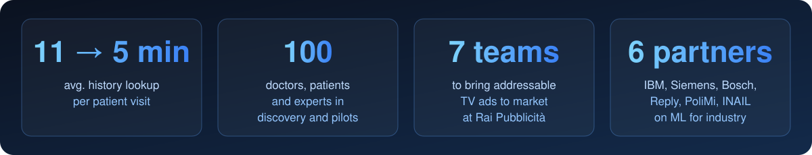
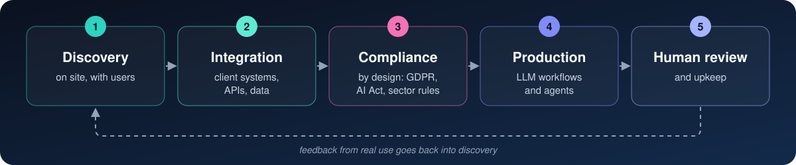
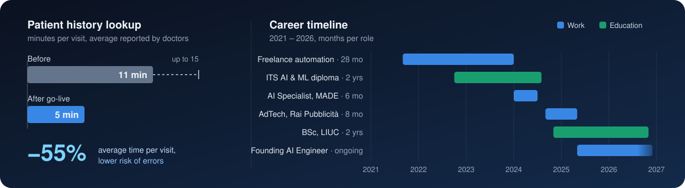

  

  
  
  

# Hi, I'm Elena 👋

**Taking generative AI and agentic systems from prototype to production,** 
**in regulated, data-sensitive settings, starting with healthcare.**

Hands-on with the people who use the product: 
doctors, patients, public bodies, SMEs and large companies.

Focus on the integration, data and compliance work 
that usually stalls a deployment.

👉 **[Let's talk: book a call](https://linktr.ee/elena.sorre)** if you are hiring or building something in this space.

## 📈 Impact

  

## 🛠️ Deployment playbook

  

## 🩺 Now

**Founding AI Engineer** · health-tech startup in stealth · *2025 – present*
- Built the product end to end: APIs, data pipelines, LLM workflows and AI agents
- A human reviews every output before it reaches a user
- Integrated clinical software and national health data platforms
- Privacy by design for GDPR, nFADP, EHDS, FHIR and MDR

**BSc in Industrial Engineering & Management** · LIUC · *2024 – 2026*
- Thesis on the health-tech product above

## 🧭 Before that

**AdTech Specialist** · Rai Pubblicità
- Brought addressable TV advertising to market across 7 teams
- Measured campaign performance with SQL on Azure

**AI Specialist** · MADE Competence Center Industry 4.0, Politecnico di Milano
- Designed an MLOps architecture for AIoT
- Developed ML use cases for manufacturing with industrial and academic partners

**Higher Diploma in AI & Machine Learning** · ITS Academy Angelo Rizzoli
- Merit scholarship
- Google Women in AI Mentorship, 2024

## 📊 Data behind it

The same path, in numbers: what changed for doctors, and how the experience built up over time.

  

## 🧰 Stack

**AI and ML** 
LLMs · AI agents · RAG · vector databases 
LLM evaluation · NLP · computer vision

**Languages, cloud and infrastructure**

  

**ML and data platforms**

  
  
  
  
  
  
  

**Health and regulation**

  
  
  
  
  
  

## 🌍 Languages

Italian (native) 
English and French (full professional) 
Spanish (professional) · German (limited) 
*Always improving, especially these last two* 🙂

## 📂 Projects

All public work is in the [Repositories](https://github.com/elenasorrentino10?tab=repositories) tab. 
The pinned ones below are the best place to start.

## 🤝 Let's work together

Open to **Forward Deployed**, **Applied AI** and **AI Solutions Engineer** roles, 
and to collaborations on AI in healthcare and other regulated industries.

If it sounds like a fit, book a short call or send a message on LinkedIn: 
a few lines about the problem you are working on are enough to start.

  
  

